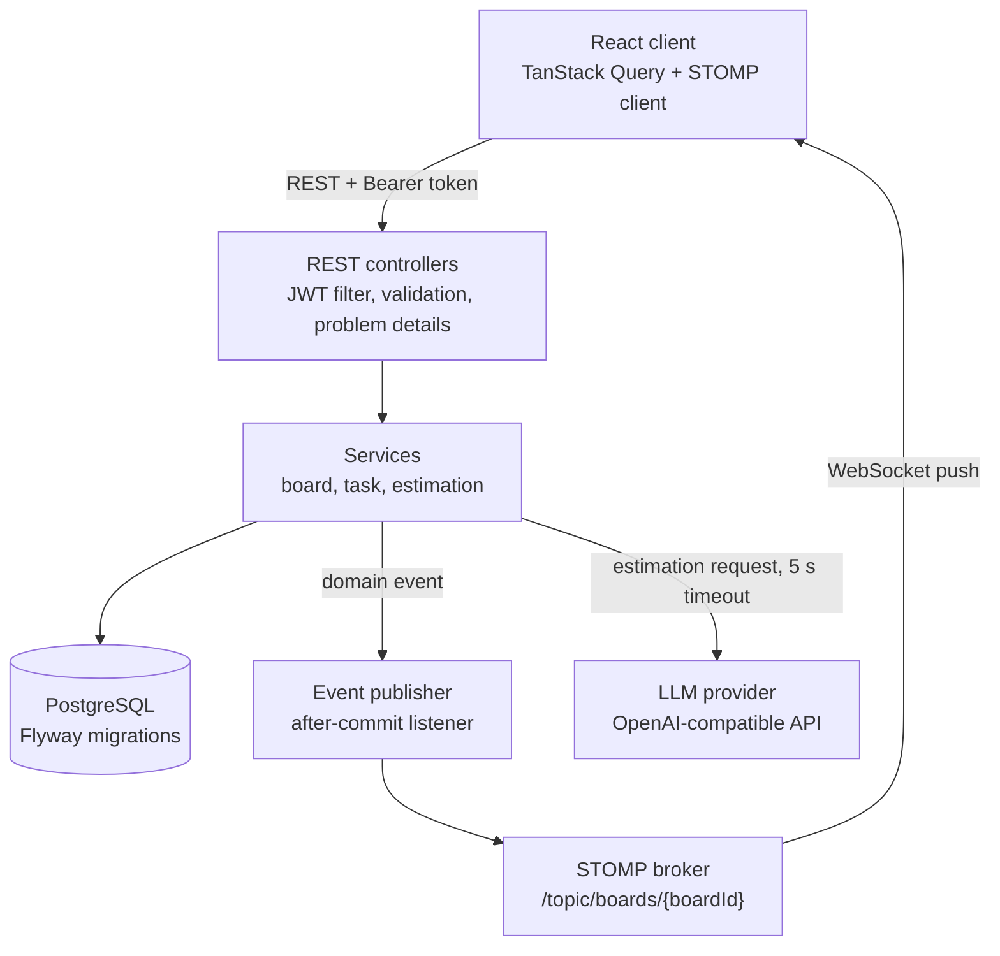
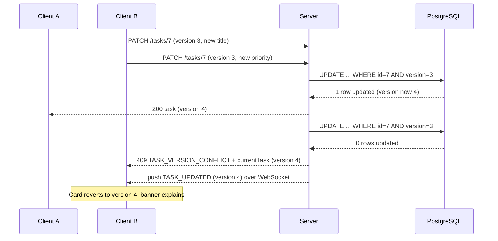

# Atlas

Atlas is a real-time collaborative task board featuring version-checked concurrent edits, live WebSocket synchronisation, and AI-assisted effort estimation with deterministic heuristic fallbacks.

## Stack and pinned versions

### Backend
- Java: 21 (Eclipse Temurin)
- Spring Boot: 3.4.3
- Apache Maven: 3.9.9 (via wrapper)
- PostgreSQL: 16 (`postgres:16-alpine`)
- Flyway: 10.20.1
- PostgreSQL JDBC Driver: 42.7.5
- Testcontainers: 1.20.4

### Frontend
- React: 18.3.1
- React DOM: 18.3.1
- TypeScript: 5.7.3 (strict mode)
- Vite: 6.2.0
- Tailwind CSS: 3.4.17
- Public Sans: 5.1.0 (`@fontsource/public-sans`)
- TanStack Query: 5.66.0 (`@tanstack/react-query`)
- dnd-kit core: 6.3.1 (`@dnd-kit/core`)
- dnd-kit sortable: 10.0.0 (`@dnd-kit/sortable`)
- STOMP client: 7.5.0 (`@stomp/stompjs`)
- Icons: 0.475.0 (`lucide-react`)
- Vitest: 3.0.7
- Testing Library (React: 16.2.0, Jest DOM: 6.6.3, User Event: 14.6.1)
- ESLint: 9.21.0

## Running with Docker Compose

Running the full application stack (PostgreSQL database, backend, and static frontend):

```bash
# 1. Copy sample environment variables
cp .env.example .env

# 2. Build and start containers
docker compose up --build
```

Services will be available at:
- Frontend: `http://localhost:5173`
- Backend API: `http://localhost:8080`
- PostgreSQL: `localhost:5432`

### Pre-seeded development dataset

When starting in the `dev` profile (default in Docker Compose and local development), a seed runner automatically creates:
- **Board:** "Checkout API, sprint 12" (Invite code: `PAYSPR12`)
- **14 tasks:** 6 completed tasks in "Done" with real historical estimates and completion timestamps, 4 in "In progress", and 4 in "To do"
- **Seed users** (all using development password `AtlasDev2026!`):
  - Priya Nair: `priya@example.test` (Owner)
  - Arjun Mehta: `arjun@example.test` (Member)
  - Sana Qureshi: `sana@example.test` (Member)

## Local development setup

### 1. Database

Start PostgreSQL 16 via Docker Compose:

```bash
docker compose up -d db
```

### 2. Backend

From the `backend` directory:

```bash
# Unix / macOS
./mvnw spring-boot:run -Dspring-boot.run.profiles=dev

# Windows
.\mvnw.cmd spring-boot:run -Dspring-boot.run.profiles=dev
```

The server listens on `http://localhost:8080`. Health check endpoint: `http://localhost:8080/actuator/health`.

### 3. Frontend

From the `frontend` directory:

```bash
npm install
npm run dev
```

The Vite dev server starts at `http://localhost:5173`.

## Environment variables

| Variable | Description | Default |
|---|---|---|
| `DB_URL` | JDBC database connection URL | `jdbc:postgresql://localhost:5432/atlas` |
| `DB_USER` | PostgreSQL user | `atlas` |
| `DB_PASSWORD` | PostgreSQL password | `atlas` |
| `ATLAS_JWT_SECRET` | Secret key for signing HS256 JWTs (minimum 32 bytes) | `dev-insecure-secret-key-at-least-32-bytes-long` |
| `ATLAS_CORS_ORIGINS` | Permitted browser origins for CORS | `http://localhost:5173` |
| `ATLAS_LLM_BASE_URL` | Base URL for OpenAI-compatible completions | *(empty: triggers keyword fallback)* |
| `ATLAS_LLM_MODEL` | Model identifier | *(empty)* |
| `ATLAS_LLM_API_KEY` | Model provider API key | *(empty)* |
| `ATLAS_LLM_TIMEOUT_MS` | Timeout in milliseconds for estimation requests | `5000` |
| `VITE_API_BASE_URL` | Base API URL for frontend | `http://localhost:8080` |
| `VITE_WS_URL` | WebSocket URL for frontend | `ws://localhost:8080/ws` |

## Project structure

```
atlas/
  AGENTS.md                 # Project working rules and quality agreements
  README.md                 # Repository guide and run instructions
  docker-compose.yml        # Docker compose definition (db, backend, frontend)
  .env.example              # Sample environment variables
  docs/
    SPEC.md                 # Product specifications and acceptance criteria
    ARCHITECTURE.md         # Technical architecture and data models
    API_CONTRACT.md         # REST and WebSocket message schemas
    DESIGN_SYSTEM.md        # UI tokens, typography, and writing standards
    PROMPTS.md              # Engineering phase descriptions
    KNOWN_LIMITATIONS.md    # Honest accounting of intentional simplifications
  backend/
    pom.xml                 # Maven configuration and pinned dependencies
    Dockerfile              # Multi-stage non-root container build
    src/main/java/com/atlas/
      AtlasApplication.java # Spring Boot entry point
      auth/                 # Authentication, JWT, and user persistence
      board/                # Board lifecycle, membership, and columns
      task/                 # Task mutations, ordering, and optimistic locking
      realtime/             # STOMP config, auth interceptor, and event publisher
      estimation/           # LLM estimation provider and heuristic fallback
      common/               # Problem details handling, security, and dev seed runner
  frontend/
    package.json            # Pinned frontend dependencies and scripts
    Dockerfile              # Multi-stage non-root Nginx container build
    nginx.conf              # SPA route fallback configuration
    src/
      api/                  # REST client, WebSocket wrapper, and API types
      components/           # Reusable UI primitives (Button, TextField, Modal, etc.)
      features/
        auth/               # Sign-in and registration views
        boards/             # Board list and join/create dialogs
        board/              # Board view, columns, and drag-and-drop orchestration
        task/               # Task cards, task drawer, and estimation block
        realtime/           # Board event reconciliation logic
      styles/               # Design tokens and Tailwind CSS imports
```

## Running tests

### Backend tests

Integration tests run against PostgreSQL via Testcontainers. Ensure Docker is running.

```bash
cd backend

# Unix / macOS
./mvnw test

# Windows
.\mvnw.cmd test
```

### Frontend tests and quality checks

From the `frontend` directory:

```bash
# Run unit and component test suite
npm test

# Check code style and rules
npm run lint

# Verify TypeScript types in strict mode
npm run typecheck

# Validate production build bundle
npm run build
```

## Architecture summary

Writes travel over REST. Live updates travel over a WebSocket (STOMP) channel that only the server publishes to. The two are linked by one rule: an event is published only after the database transaction that caused it has committed.



## Conflict guarantee

An accepted write was computed from the latest committed version of that task, so no committed write is ever overwritten without the writer having seen it. Every update, move, and deletion sends the version the client last observed. Stale mutations fail immediately either during early version comparison or through Hibernate optimistic locking (`@Version`), returning HTTP 409 `TASK_VERSION_CONFLICT` along with the latest task representation so the client can present the conflict and reconcile without silent data loss.


