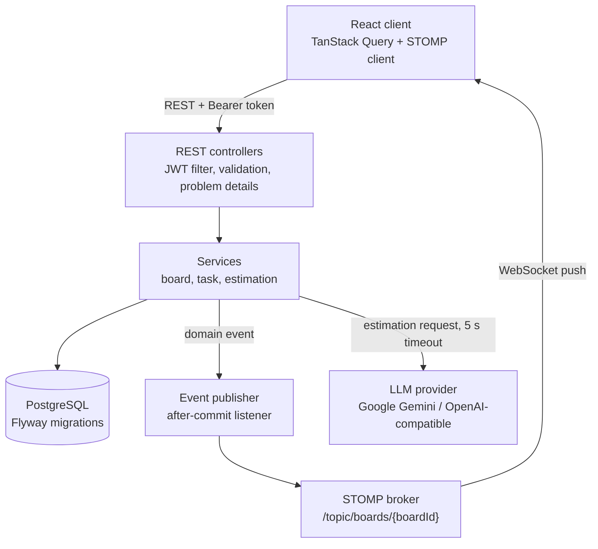
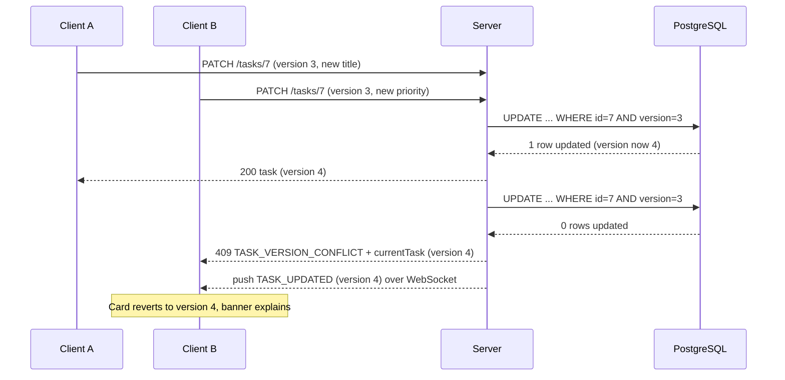

# Atlas

Atlas is a real-time collaborative task board featuring version-checked concurrent edits, live WebSocket synchronisation, and AI-assisted effort estimation with deterministic heuristic fallbacks.

## Live demo

- **Web application:** [https://atlas-taskboard.up.railway.app](https://atlas-taskboard.up.railway.app)
- **Deployment platform:** Railway (PostgreSQL 16, Java 21 Spring Boot backend, and Nginx React frontend)

### Demo credentials

The live deployment is pre-seeded with the development dataset and demo accounts:

| User | Email | Password | Role |
|---|---|---|---|
| Priya Nair | `priya@example.test` | `AtlasDev2026!` | Board Owner |
| Arjun Mehta | `arjun@example.test` | `AtlasDev2026!` | Member |
| Sana Qureshi | `sana@example.test` | `AtlasDev2026!` | Member |

- **Pre-loaded board:** Checkout API, sprint 12
- **Board invite access:** Invite codes use rolling 7-day expiration with auto-rotation. Sign in as Priya Nair (Owner) to view, copy, or regenerate the active invite code in Board Settings.
- **Pre-loaded tasks:** 14 tasks with realistic technical descriptions, historical estimates in hours, priorities, and audit timestamps.

---

## Key capabilities

1. **Optimistic locking and conflict preservation:** Every task mutation (drag-and-drop move, title edit, description update, priority change) submits its expected version. Concurrent writes that collide are rejected with HTTP 409 `TASK_VERSION_CONFLICT`. The frontend immediately displays a conflict notification explaining who made the modification, reverts the stale card to the server state, and preserves the active user's uncommitted draft in the drawer so work is never silently lost.
2. **Real-time synchronisation:** Task movements, creations, and edits are broadcast over a STOMP WebSocket channel (`/topic/boards/{boardId}`) strictly after database transactions commit (`AFTER_COMMIT`), with visual cues ("Moved by Arjun") highlighting active changes across peer browsers.
3. **AI effort estimation:** Estimates effort in hours (0.5 to 40.0) and suggests priorities based on task context and completed team tasks. Powered by Google Gemini (OpenAI-compatible endpoint) with automatic fallback to a deterministic keyword-based heuristic estimator when external models are unavailable or rate-limited.
4. **Board and member management:** Dedicated role-based controls (Owner vs Member). Board owners can remove members with automatic task unassignment (`assigneeId = null`) to prevent dangling assignments. Invite codes carry a rolling 7-day expiration (`invite_code_expires_at`), auto-rotate on owner access once expired, and support manual on-demand regeneration. Members can leave boards; owners can delete boards with cascade cleanup.
5. **Productivity and keyboard workflows:** Global Command Palette (`Cmd+K` / `Ctrl+K`) for rapid navigation, search, and action execution; instant board search and quick filter pills (Priority: High / Medium / Low, and Assignee filtering); inline column task quick-add; and visual sprint progress tracking.

---

## Stack and pinned versions

### Backend
- Java: 21 (Eclipse Temurin)
- Spring Boot: 3.4.3
- Apache Maven: 3.9.9 (via wrapper)
- PostgreSQL: 16 (`postgres:16-alpine`)
- Flyway: 10.20.1
- PostgreSQL JDBC Driver: 42.7.5
- Nimbus JOSE + JWT: 9.37.3
- Spring Security: 6.4.3
- Testcontainers: 1.20.4

### Frontend
- React: 18.3.1
- React DOM: 18.3.1
- TypeScript: 5.7.3 (strict mode)
- Vite: 6.2.0
- Tailwind CSS: 3.4.17
- Public Sans: 5.1.0 (`@fontsource/public-sans`)
- TanStack Query: 5.66.0 (`@tanstack/react-query`)
- dnd-kit core: 6.3.1 (`@dnd-kit/core`)
- dnd-kit sortable: 10.0.0 (`@dnd-kit/sortable`)
- STOMP client: 7.5.0 (`@stomp/stompjs`)
- Icons: 0.475.0 (`lucide-react`)
- Vitest: 3.0.7
- Testing Library (React: 16.2.0, Jest DOM: 6.6.3, User Event: 14.6.1)
- ESLint: 9.21.0

---

## Architecture summary

Writes travel over REST. Live updates travel over a WebSocket (STOMP) channel that only the server publishes to. The two are linked by one rule: an event is published only after the database transaction that caused it has committed.



---

## Conflict guarantee

An accepted write was computed from the latest committed version of that task, so no committed write is ever overwritten without the writer having seen it. Every update, move, and deletion sends the version the client last observed. Stale mutations fail immediately either during early version comparison or through Hibernate optimistic locking (`@Version`), returning HTTP 409 `TASK_VERSION_CONFLICT` along with the latest task representation so the client can present the conflict and reconcile without silent data loss.



---

## Project structure

```
atlas/
  AGENTS.md                 # Project working rules and quality agreements
  README.md                 # Repository guide and live deployment references
  docker-compose.yml        # Multi-container production deployment definition
  .env.example              # Sample environment variables
  docs/
    SPEC.md                 # Product specifications and acceptance criteria
    ARCHITECTURE.md         # Technical architecture and data models
    API_CONTRACT.md         # REST and WebSocket message schemas
    DESIGN_SYSTEM.md        # UI tokens, typography, and writing standards
    PROMPTS.md              # Engineering phase descriptions
    KNOWN_LIMITATIONS.md    # Honest accounting of intentional simplifications
  backend/
    pom.xml                 # Maven configuration and pinned dependencies
    Dockerfile              # Multi-stage non-root container build
    src/main/java/com/atlas/
      AtlasApplication.java # Spring Boot entry point
      auth/                 # Authentication, JWT, and user persistence
      board/                # Board lifecycle, membership, and columns
      task/                 # Task mutations, ordering, and optimistic locking
      realtime/             # STOMP config, auth interceptor, and event publisher
      estimation/           # LLM estimation provider and heuristic fallback
      common/               # Problem details handling, security, and dev seed runner
  frontend/
    package.json            # Pinned frontend dependencies and scripts
    Dockerfile              # Multi-stage non-root Nginx container build
    nginx.conf              # SPA route fallback configuration
    src/
      api/                  # REST client, WebSocket wrapper, and API types
      components/           # Reusable UI primitives (Button, TextField, Modal, etc.)
      features/
        auth/               # Sign-in and registration views
        boards/             # Board list and join/create dialogs
        board/              # Board view, columns, and drag-and-drop orchestration
        task/               # Task cards, task drawer, and estimation block
        realtime/           # Board event reconciliation logic
      styles/               # Design tokens and Tailwind CSS imports
```

---

## Automated test suites

Both suites run on every commit through GitHub Actions Continuous Integration.

### Backend tests

Unit and web integration tests (including optimistic concurrency verification and Testcontainers PostgreSQL integration):

```bash
cd backend
./mvnw test        # Unix / macOS
.\mvnw.cmd test    # Windows
```

### Frontend tests and quality checks

Unit, component, reconciliation, and integration tests with strict TypeScript compilation:

```bash
cd frontend
npm test           # Run 75 Vitest unit and component tests across 11 test suites
npm run lint       # ESLint rules check
npm run typecheck  # TypeScript strict mode verification
npm run build      # Production bundle verification
```
